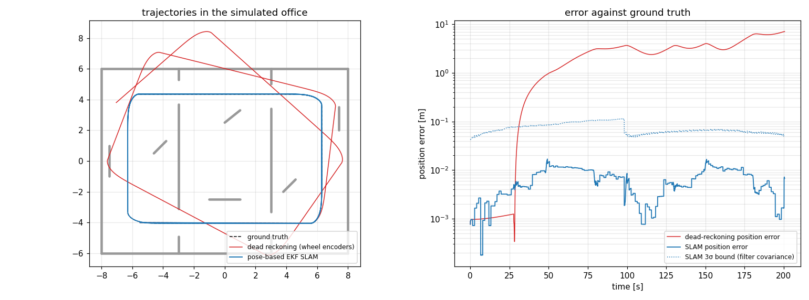
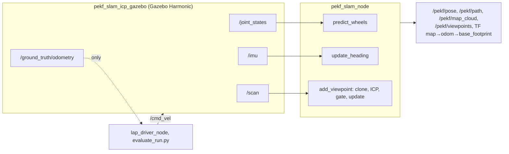

# Pose-Based EKF SLAM with ICP Scan Matching (ROS 2)

Pose-based (delayed-state) EKF SLAM for a differential-drive robot with a 2-D lidar, in C++ for **ROS 2 Jazzy** and
**Gazebo Harmonic** on Ubuntu 24.04. Wheel encoders predict the motion, an IMU corrects the heading, and ICP between
the current scan and overlapping stored scans corrects the whole trajectory.



## Result

Two scripted laps of the simulated office (Gazebo, 360-beam lidar with 1 cm range noise), with and without the IMU, compared with the
simulator's ground truth by [`evaluate_run.py`](pekf_slam_icp/scripts/evaluate_run.py). The CSV logs and the figure
are in [`docs/results/`](docs/results); `python3 tools/plot_run.py docs/results/<run>.csv out.png` recomputes the
numbers.

| run (2 laps, 200 s, ~84 m) | ATE SLAM | ATE dead reckoning | max SLAM error | final error SLAM / dead reckoning | mean NEES (ideal 3) |
|---|---|---|---|---|---|
| with IMU ([csv](docs/results/two_laps_imu.csv), [figure](docs/results/two_laps_imu.png)) | **0.007 m** | 3.323 m | 0.017 m | 0.007 m / 7.098 m | 0.25 |
| without IMU ([csv](docs/results/two_laps_no_imu.csv), [figure](docs/results/two_laps_no_imu.png)) | **0.027 m** | 3.330 m | 0.079 m | 0.009 m / 7.098 m | 0.13 |

Without the IMU, the error grows to 8 cm in the first lap while the heading is corrected only by scan matching between
neighbouring viewpoints. It falls back to millimetres when the loop closes, at about 98 s, and the 3σ bound collapses
from 1.8 m to 6 cm (see the figure). In both runs the mean NEES is below 3: the filter is *conservative*, and the
covariance it reports is larger than its actual error. That is the safe side to err on.

The dead-reckoning error is systematic: in every turn the encoders report about 8 % less rotation than the robot
actually makes (`plot_run.py` prints the ratio, 0.92) — the simulated cylinder wheels touch the ground nearer their inner
edges, so the effective wheel separation is shorter than the nominal 0.5 m. Real robots have the same kind of error
until their odometry is calibrated; the filter is not told about it and corrects it with the IMU and the scans.

## How it works

The filter state holds the current robot pose and the poses of the *viewpoints*, the places where a scan was stored:
$y = [x_k;\ v_1; \dots; v_n]$ with one joint covariance.

1. **Prediction** — wheel encoder increments, arc model; only the current pose and its cross-covariances change.
2. **Heading update** — the IMU yaw, a scalar EKF update.
3. **New viewpoint** — after 0.5 m or 0.4 rad of motion the current pose is *cloned* into the state (exact
   cross-covariances) and the scan is stored with it.
4. **Scan matching** — the new scan is matched with point-to-line ICP against the nearest stored scans within
   1.5 m + 3σ, starting from the relative pose the filter predicts.
5. **Gated update** — each match is a measurement $z = \ominus v_i \oplus x_k$ with the ICP covariance; it updates the
   filter only if it passes an individual-compatibility test, $\nu^TS^{-1}\nu < \chi^2_3(0.999)$. A wrong ICP minimum
   reports a small covariance, so this gate is what keeps it out.

The map is the stored scans drawn at their estimated viewpoints. The theory behind each step — pose compounding, EKF,
gating, state augmentation, ICP and its covariance — is in
[learn-state-estimation](https://github.com/Rudip1/learn-state-estimation), chapters 2, 6, 8, 9 and 10; this package
uses that library (pinned to a commit) for the pose algebra, motion model, ICP and χ² quantiles.



## Packages

| package | contents |
|---|---|
| [`pekf_slam_icp`](pekf_slam_icp) | `PoseEkfSlam` (ROS-free C++ core), `pekf_slam_node`, `lap_driver_node`, `evaluate_run.py`, launch, parameters, RViz, tests |
| [`pekf_slam_icp_gazebo`](pekf_slam_icp_gazebo) | robot (URDF/xacro: diff drive, 2-D lidar, IMU), office world, ros_gz bridge, simulation launch |

## Build

Ubuntu 24.04, ROS 2 Jazzy, Gazebo Harmonic (`ros-jazzy-ros-gz`).

```bash
mkdir -p ~/pekf_ws/src && cd ~/pekf_ws/src
git clone https://github.com/Rudip1/pekf-slam-icp.git
cd ~/pekf_ws
rosdep install --from-paths src --ignore-src -y
source /opt/ros/jazzy/setup.bash
colcon build --cmake-args -DCMAKE_BUILD_TYPE=Release
source install/setup.bash
```

The first build downloads learn-state-estimation (pinned commit). Offline, point CMake at a local checkout:
`colcon build --cmake-args -DFETCHCONTENT_SOURCE_DIR_LEARN_STATE_ESTIMATION=/path/to/learn-state-estimation`.

## Run

```bash
# Gazebo + SLAM + RViz; drive with teleop on /cmd_vel
ros2 launch pekf_slam_icp pekf_slam.launch.py
ros2 run teleop_twist_keyboard teleop_twist_keyboard

# The reproducible experiment: two scripted laps, headless, evaluated against ground truth, then shut down
ros2 launch pekf_slam_icp pekf_slam.launch.py gui:=false rviz:=false drive:=true evaluate:=true output:=run.csv
python3 src/pekf-slam-icp/tools/plot_run.py run.csv run.png

# Without IMU heading updates
ros2 launch pekf_slam_icp pekf_slam.launch.py drive:=true evaluate:=true use_imu:=false
```

Parameters (robot geometry, noise, viewpoint spacing, ICP and gate settings) are in
[`config/pekf_slam.yaml`](pekf_slam_icp/config/pekf_slam.yaml).

## Tests

```bash
colcon test --packages-select pekf_slam_icp && colcon test-result --verbose
```

The algorithm tests need no simulator: prediction equals dead reckoning (mean and covariance); cloning is exact and
prediction leaves the viewpoints untouched; the heading update is the scalar Kalman update; a corrupted scan match is
rejected by the gate; and two laps through learn-state-estimation's simulated office stay accurate and consistent
for three random seeds, with no wrong match accepted.

The scripted driver (`LapFollower`, ROS-free, used by `lap_driver_node`) follows the route's segments with a
look-ahead point rather than aiming at waypoints, so it passes through the doorways instead of cutting corners into
the jambs. Its test drives an ideal unicycle around two laps of the Gazebo office and requires at least 0.15 m between
the robot's footprint and any wall; it also checks the slow-down in front of an obstacle and the back-off when the
robot makes no progress.

## Limitations

- An EKF linearises once. Without the IMU, the heading uncertainty grows large before the first loop closes (3σ of
  1.8 m here); in a larger environment with longer loops the linearisation error would then stay in the estimate. An optimisation back end re-linearises — chapter 10 of
  learn-state-estimation solves the same problem with a pose graph.
- The covariance is dense, so the cost of an update grows with the square of the number of viewpoints (one per
  0.5 m of travel); for large maps use a pose graph.
- Tested in simulation only. The ROS 1 version (TurtleBot 2 in Stonefish, Python) is kept at tag
  [`ros1-noetic`](https://github.com/Rudip1/pekf-slam-icp/tree/ros1-noetic).

## Acknowledgements

Developed by Pravin Oli. The ROS 2 / C++ version reuses
[learn-state-estimation](https://github.com/Rudip1/learn-state-estimation).

## License

[Apache License 2.0](LICENSE). Citation metadata: [CITATION.cff](CITATION.cff).
